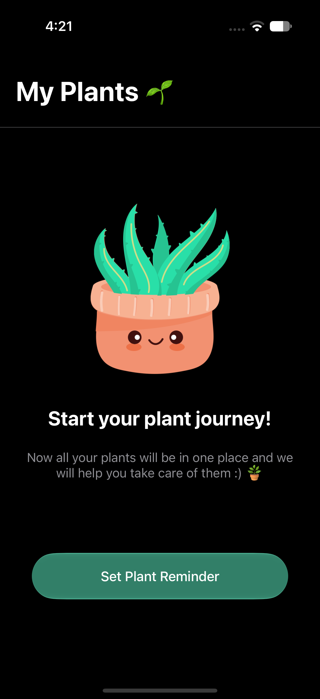
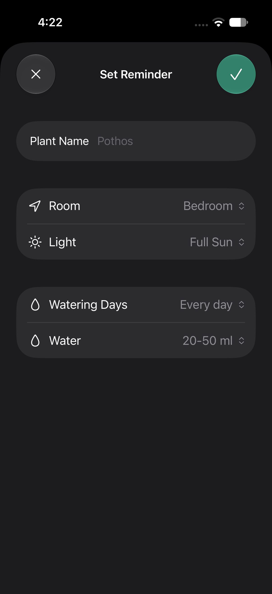
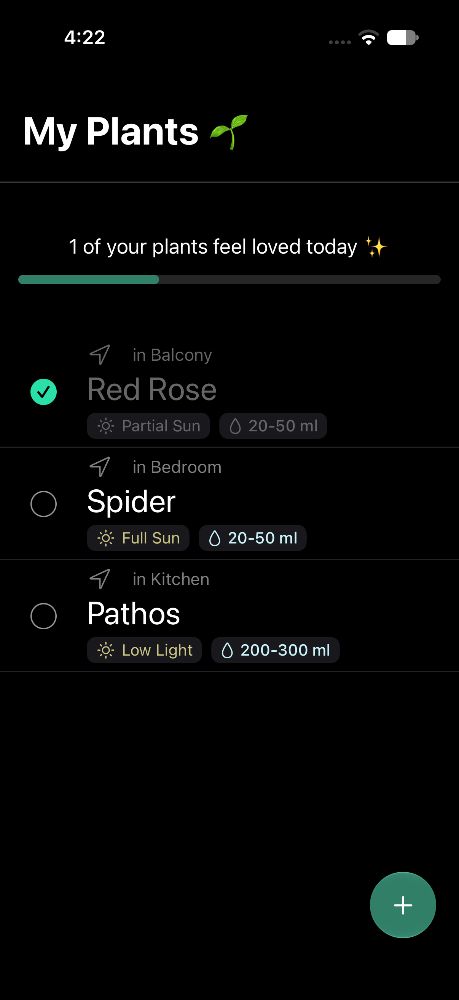
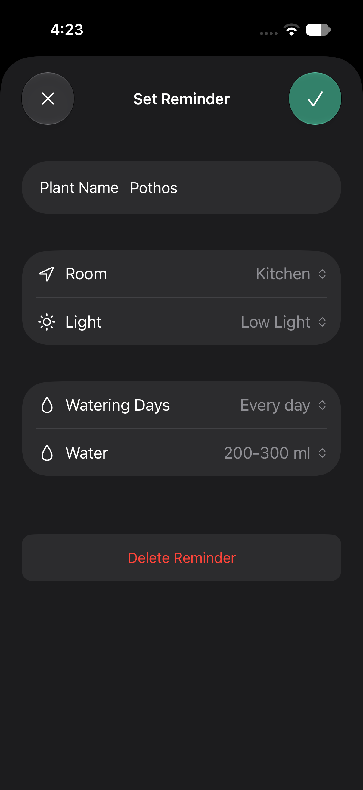
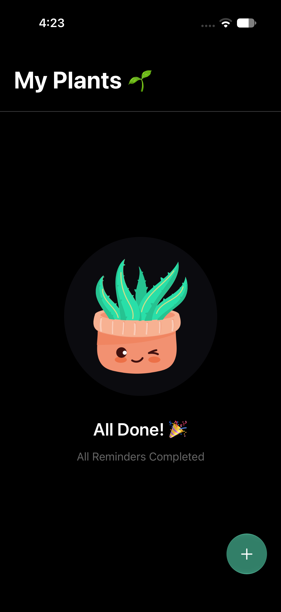
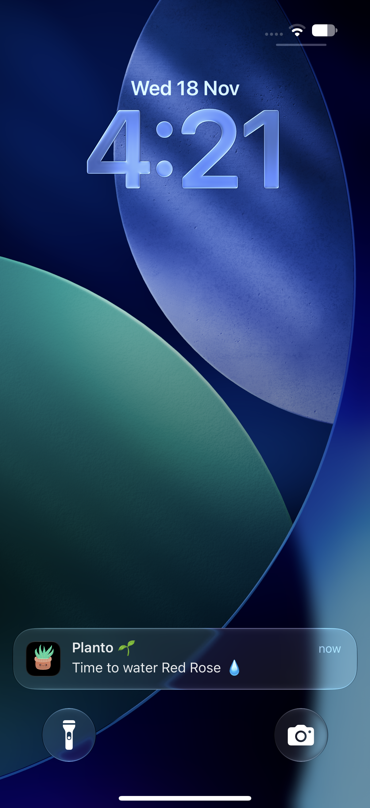

# Planto 🌱

A simple iOS app designed to help users manage their plants and stay on track with watering reminders.

Developed as an individual challenge at Apple Developer Academy.

## Features

- Add, edit, and delete plant reminders.
- Choose room, light conditions, watering frequency, and water amount.
- View daily watering reminders.
- Mark reminders as completed or incomplete.
- Track daily watering progress with an animated progress bar.
- Schedule local watering notifications.
- Dark mode interface with Liquid Glass buttons.

## Technologies

- Swift & SwiftUI
- MVVM Architecture
- UserNotifications
- Liquid Glass

## Project Structure

- **Models:** Plant data and enums.
- **ViewModels:** Plant management and app logic.
- **Views:** App screens.
- **Components:** Reusable UI elements.
- **Services:** Local notifications.
- **DesignSystem:** Colors and typography.

## App Screenshots 📱

A preview of Planto's interface, implemented in SwiftUI based on the provided Sketch design.

| Home Screen | Set Reminder | Today's Reminders |
|---|---|---|
|  |  |  |

| Edit Reminder | All Done | Local Notification |
|---|---|---|
|  |  |  |

## Challenge

Built as part of Challenge 2 at Apple Developer Academy, focusing on Swift, SwiftUI, MVVM, data modeling, and implementing a provided Sketch design.
